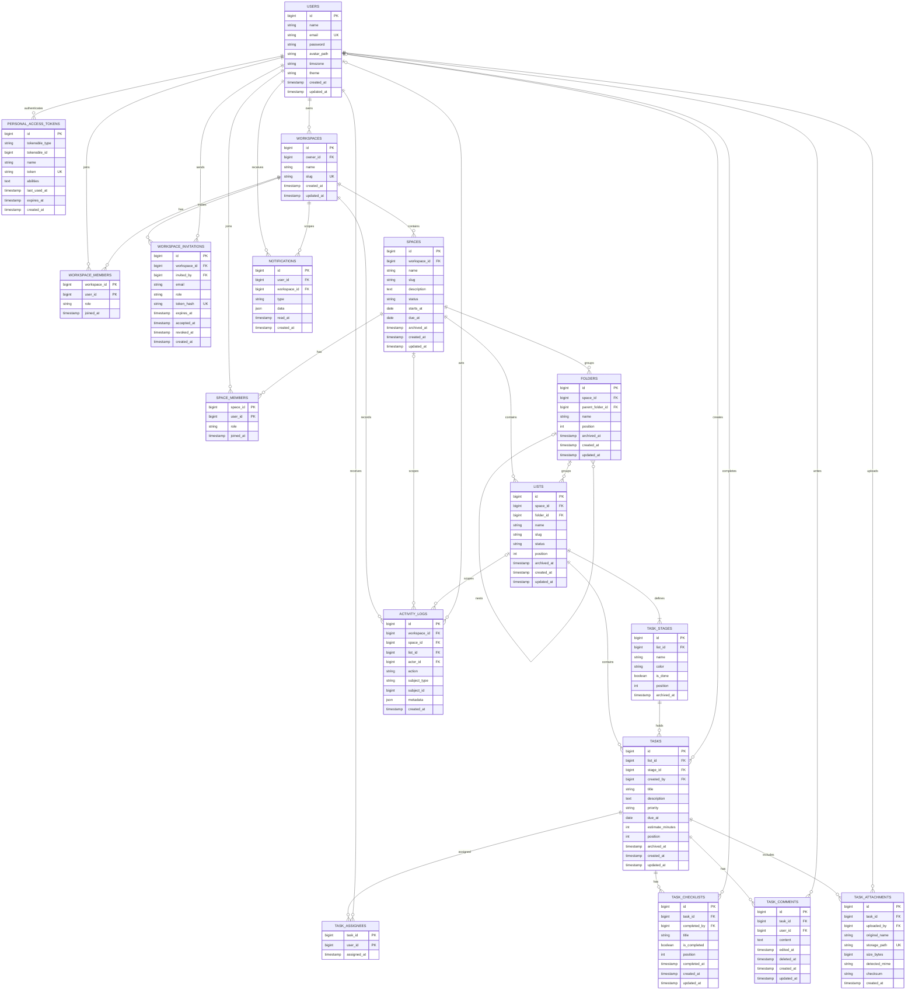
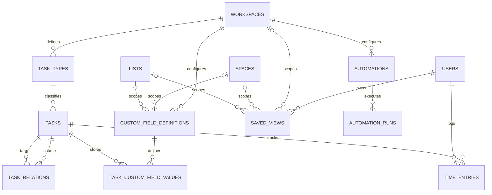

# ERD — NexSphere Project Management

Versi 1.0 · Selaras dengan [PRD.md](PRD.md) dan [PROJECT_PLAN.md](PROJECT_PLAN.md)

Diagram ini menggambarkan fondasi data untuk MVP dan jalur perluasan. **MVP** menggunakan Workspace → Space → List → Task; Folder bisa dibuat dalam skema tetapi UI-nya ditunda. Bagian ekstensi adalah rancangan untuk tahap berikutnya, bukan scope implementasi MVP.

## 1. ERD fondasi MVP

## 2. Aturan integritas dan akses

- Seluruh tabel data milik pelanggan diturunkan ke `workspace_id` secara langsung atau lewat relasi yang tervalidasi. Policy harus memeriksa tenant scope pada setiap operasi; ID yang valid tidak berarti pengguna berhak mengaksesnya.
- `workspaces.owner_id` harus menunjuk user yang menjadi anggota workspace dengan role `owner`. Transfer owner dilakukan dalam transaksi; workspace tidak boleh tanpa owner.
- Unique constraint yang disarankan: `(workspace_id,user_id)` di `workspace_members`; `(space_id,user_id)` di `space_members`; `(workspace_id,slug)` di `spaces`; `(space_id,slug)` untuk `lists`; `(task_id,user_id)` untuk `task_assignees`.
- `lists.folder_id` boleh `NULL` untuk list langsung di Space. Bila terisi, Folder harus berada dalam `space_id` yang sama. `folders.parent_folder_id` harus menunjuk folder pada Space yang sama dan tidak boleh membentuk siklus.
- `tasks.stage_id` harus menunjuk stage milik `tasks.list_id`. Assignee harus menjadi anggota Space yang menaungi List. Pindah task antar-List memerlukan validasi akses dan stage tujuan.
- Setiap List memiliki minimal satu stage bertanda `is_done`; penghapusan/arsip stage yang masih berisi task harus dicegah atau didahului pemindahan task secara atomik.
- `notifications.workspace_id` memudahkan pembatasan tenant dan penghapusan/retensi data. Kolom `data` tidak boleh menjadi tempat menyimpan rahasia.
- `personal_access_tokens` mengikuti tabel Sanctum; `tokenable_type/id` adalah relasi morph. Nilai token yang tersimpan harus berupa hash sesuai implementasi Sanctum, bukan token mentah.
- `activity_logs.subject_type/subject_id` adalah relasi polimorfik untuk objek yang dicatat, sehingga tidak memiliki foreign key langsung. Pertahankan `workspace_id` dan scope terkait untuk otorisasi serta retensi.
- File attachment disimpan privat dengan path acak; nama file asli hanya metadata. Unduh selalu melalui endpoint yang memeriksa akses task.
- Gunakan `archived_at` untuk arsip yang dapat dipulihkan. Kebijakan hard delete dan retensi komentar, aktivitas, serta file ditentukan terpisah.

> Beberapa aturan lintas tabel (misalnya stage dan task harus dalam List yang sama) mungkin tidak dapat dijamin dengan foreign key sederhana. Validasi domain dan operasi transaksional tetap wajib; constraint database ditambahkan bila engine target mendukungnya dengan aman.

## 3. Ekstensi data pasca-MVP

Entitas ini ditambahkan saat fitur terkait diprioritaskan. Rancangan menyimpan referensi ke task yang sama, bukan menggandakan task per tampilan.

Kolom konsep yang perlu diputuskan saat implementasi:

- `task_types`: `workspace_id`, nama, konfigurasi, status aktif.
- `custom_field_definitions`: scope (`workspace_id`, `space_id`, atau `list_id`), nama, key, tipe, aturan validasi, urutan, dan status aktif. Terapkan aturan agar scope tepat satu tingkat yang diizinkan.
- `task_custom_field_values`: unique `(task_id, custom_field_definition_id)`; gunakan kolom nilai bertipe (teks, angka, tanggal, boolean, JSON terbatas) sesuai tipe field dan kebutuhan filter. Jangan gunakan JSON bebas untuk semua nilai tanpa indeks dan validasi.
- `task_relations`: `source_task_id`, `target_task_id`, `relation_type`; cegah self-link dan siklus untuk jenis dependency.
- `saved_views`: owner, scope, view type, filter, sort, grouping, dan kolom yang terlihat sebagai konfigurasi tervalidasi.
- `time_entries`: task, user, waktu mulai/selesai atau durasi, deskripsi opsional; perubahan dan retensinya dapat diaudit.
- `automations` dan `automation_runs`: definisi trigger/action berversi, status, idempotency key, hasil, error, dan retry. Jangan mengeksekusi kode bebas dari pengguna.

## 4. Keputusan sebelum migration pertama

1. Pilih satu format ID untuk semua tabel (big integer atau UUID/ULID); jangan mencampur tanpa alasan.
2. Tetapkan collation dan strategi pencarian yang cocok untuk MySQL/MariaDB hosting target.
3. Putuskan apakah Folder dibuat di database MVP meski belum ada UI. Rekomendasi: buat relasi `folder_id` nullable pada List dan entitas Folder sederhana agar penambahan Folder tidak memerlukan migrasi ulang struktur List.
4. Putuskan strategi soft delete, retensi, backup, timezone, dan batas ukuran lampiran.
5. Tinjau foreign key, unique index, cascade behavior, dan urutan migration terhadap engine database yang benar-benar dipakai.
