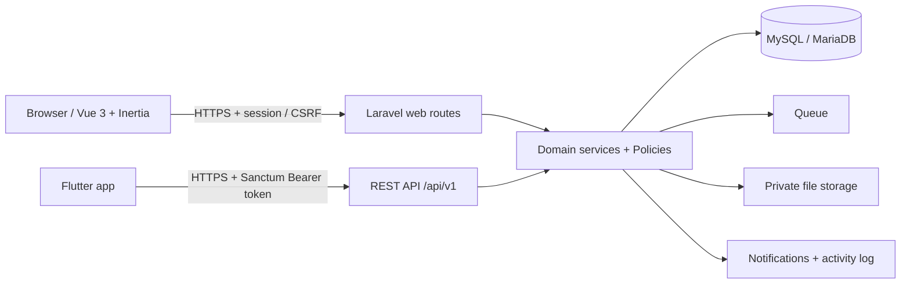

# Project Plan — NexSphere Project Management

| Atribut | Nilai |
|---|---|
| Versi | 1.3 |
| Status | Draft teknis; validasi hosting dan keputusan produk masih terbuka |
| Product requirements | [PRD.md](../product/PRD.md) |
| Entity relationship diagram | [ERD.md](../architecture/ERD.md) |
| Target awal | MVP web untuk tim pilot di shared hosting |
| Sasaran kualitas | Skalabel, mudah dirawat, andal |

Dokumen ini menerjemahkan kebutuhan PRD menjadi model teknis, fase kerja, dan strategi rilis. Tujuan arsitektur adalah platform kerja modular yang dapat tumbuh bertahap menuju fleksibilitas produk seperti ClickUp; MVP tetap kecil. Jadwal kalender belum ditetapkan karena ukuran tim, kapasitas kerja, dan kondisi hosting belum dikonfirmasi.

> **Catatan:** Ini adalah rencana teknis berstatus draft, bukan catatan implementasi yang selalu mutakhir. Sebelum menjalankan instruksi atau menganggap sebuah fitur sudah ada, verifikasi struktur, konfigurasi, kode, dan tes pada checkout saat ini.

## 1. Prinsip implementasi

- Bangun alur kerja inti lebih dulu dan hindari fitur yang tidak mendukung pilot.
- Semua akses data dibatasi di server berdasarkan workspace dan keanggotaan Space; akses List/task mengikuti container pada MVP.
- Database adalah sumber kebenaran; broadcast, cache, dan optimistic UI tidak boleh menggantikan persistensi.
- Infrastruktur dibuat portabel melalui konfigurasi Laravel, tetapi migrasi hosting tetap memerlukan rencana operasional dan cutover.
- Sebelum mengunci versi framework atau layanan, verifikasi versi PHP dan fitur yang tersedia pada akun hosting serta lingkungan lokal/staging.
- Model domain memisahkan container kerja, task, field task, dan definisi view supaya penambahan fitur tidak mengubah arti data lama.
- Ekstensi harus memakai migrasi terencana dan kontrak domain; jangan membangun sistem plugin generik sebelum ada kebutuhan nyata.
- Workspace adalah batas tenant; query, file, cache, job, log aktivitas, dan notifikasi harus tetap dalam scope tenant yang tervalidasi.

## 2. Arsitektur MVP dan arah evolusi

### Stack awal

| Area | Pilihan | Catatan |
|---|---|---|
| Backend | Laravel, versi stabil yang kompatibel dengan PHP hosting | Dokumen awal menyebut Laravel 13/PHP 8.3; validasi dukungan aktual sebelum instalasi/deploy. |
| UI | Vue 3 + Inertia, tema NexSphere/MasterHub, Bootstrap 5 assets | Vue page/components menjadi UI utama; gunakan Bootstrap theme/assets seperlunya dan hindari konflik global Tailwind/Bootstrap. |
| Kanban | SortableJS + endpoint Laravel | Update posisi divalidasi dan disimpan dalam transaksi. |
| Database | MySQL/MariaDB | Tambahkan foreign key, indeks untuk filter, unique constraint, dan aturan delete yang jelas. |
| Queue/cache | Database queue untuk baseline | Redis opsional setelah koneksi dan proses worker di paket hosting dibuktikan. Cache dan queue adalah kebutuhan yang berbeda. |
| Realtime | Notifikasi tersimpan untuk baseline; polling ringan bila dibutuhkan | Pusher/Reverb masuk rilis berikutnya. Real-time hanya lapisan pengiriman; simpan notifikasi sebelum broadcast. |
| Lampiran | Laravel Storage disk private | Download melalui controller berotorisasi; hindari file privat di `public_html`. |
| Build frontend | Vite + Vue plugin + Inertia client | Build aset statis untuk MVP; SSR tidak diperlukan sampai ada kebutuhan SEO/first-render yang terukur. |
| API/mobile auth | REST API `/api/v1` + Laravel Sanctum token untuk mobile | Web Vue/Inertia memakai session; API dan web menggunakan domain/Policy yang sama. |

### Keputusan template dan frontend

- Gunakan tema admin NexSphere/MasterHub yang sudah tersedia sebagai fondasi visual: warna, typography, ikon, Bootstrap styles, gambar, dan pola layout.
- `masterhub/` saat ini adalah aplikasi Laravel tersendiri dengan domain control plane (tenant, paket, billing, telemetri). Untuk aplikasi Project Management, gunakan lapisan UI yang relevan saja; jangan salin model, controller, middleware, atau alur bisnis MasterHub ke domain produk ini.
- Frontend produk memakai Vue 3 + Inertia. Shell Blade MasterHub tidak digunakan sebagai halaman aplikasi langsung; konversi sidebar, header, navigasi, auth shell, dan pola layout menjadi Vue layouts/components.
- Codebase `masterhub/` yang ada saat ini masih menggunakan Blade dan belum memiliki dependensi Vue/Inertia; ini adalah target arsitektur, sehingga Fase 0/1 perlu memasang adapter dan membangun frontend Vue/Inertia sebelum fitur UI produk.
- Adaptasikan kebutuhan layout yang saat ini bergantung pada data MasterHub seperti `$siteSetting` menjadi konfigurasi produk dan shared props Inertia. Jangan membawa controller atau business model MasterHub.
- Pertahankan Bootstrap 5 sebagai sistem styling utama agar tema tetap konsisten. Hindari memasang Tailwind v4 secara global bersamaan kecuali ada kebutuhan jelas; seluruh aset dikelola Vite.
- Bungkus UI berulang (button, form, modal, badge, empty state, table, navigation) sebagai Vue components. Inisialisasi plugin JS seperti SortableJS dalam lifecycle component agar tidak bertabrakan dengan virtual DOM Vue.
- Gunakan Inertia untuk navigasi dan form web. Jangan membuat REST API hanya untuk menggantikan komunikasi internal Vue/Inertia; API v1 dibuat untuk mobile Flutter dan integrasi eksternal.

**Batas modular aplikasi:** pisahkan domain Workspace/Access, Work Structure, Tasks, Collaboration, Notifications, dan Reporting melalui service/action dan Policy yang jelas. MVP tetap satu aplikasi Laravel (monolith modular); microservices tidak diperlukan. Web memakai adapter Vue/Inertia; Flutter memakai REST API. Keduanya membaca dan mengubah domain yang sama, bukan mengikat UI hanya ke Kanban.

### Strategi API untuk Flutter

- Web Vue/Inertia memakai route Laravel dan session auth. Flutter memakai REST API versioned di `/api/v1`; Inertia bukan endpoint API mobile.
- Route API, web controller, dan job memanggil service/action domain yang sama. Jangan menyalin aturan bisnis ke controller API atau aplikasi Flutter.
- Lindungi API mobile dengan Laravel Sanctum personal access token. Sediakan login token berbasis kredensial dan nama perangkat, endpoint profil, logout/revoke token, daftar perangkat aktif, expiry/rotation yang diputuskan, throttling, dan TLS.
- Flutter menyimpan token di secure storage sistem operasi. Token tidak masuk log/analytics; sediakan cara revoke per perangkat. Sanctum token abilities hanya lapisan pembatas tambahan, bukan pengganti Policy atau pemeriksaan workspace.
- Kembalikan API Resource yang stabil: bentuk JSON konsisten, error terstruktur, pagination/filter terdokumentasi, timestamp UTC, dan status HTTP yang benar. Gunakan cursor pagination untuk feed panjang bila diperlukan.
- Simpan kontrak API di OpenAPI atau dokumentasi setara dan perbarui bersama endpoint. Perubahan yang memutus kompatibilitas didokumentasikan dan mendapat versi baru atau masa transisi.
- MVP menyediakan endpoint inti untuk auth, user, workspace, Space/List, task, assignee, checklist, komentar, dan notifikasi. Flutter UI lengkap menjadi fase produk tersendiri.

### Strategi pertumbuhan

- **Awal:** satu aplikasi Laravel modular, satu database relasional, batas tenant berbasis workspace, pagination, dan indeks. Gunakan transaksi untuk perubahan lintas record.
- **Pertumbuhan menengah:** pisahkan proses web dan queue worker; pindahkan file ke object storage kompatibel S3; tambah Redis untuk cache/queue/rate limiting bila metrik membenarkan; tambah monitoring dan alerting.
- **Skala lebih besar:** ukur bottleneck sebelum mengubah arsitektur. Pertimbangkan read replica, pemisahan database tenant, atau layanan terpisah hanya bila beban, isolasi pelanggan, dan kebutuhan operasional menuntutnya.
- Jangan melakukan sharding, microservices, atau multi-region pada MVP tanpa data beban dan target availability yang mendukungnya.

## 3. Model data yang diselaraskan dengan PRD

Gunakan ID konsisten (big integer atau UUID, dipilih sebelum migrasi pertama). Semua tabel domain memiliki timestamps; data sensitif memakai kebijakan soft delete/retensi yang ditetapkan.

| Entitas | Kolom/relasi utama | Aturan penting |
|---|---|---|
| `users` | name, email unique, password, avatar path, timezone, theme | Password dan token memakai mekanisme hashing Laravel. |
| `personal_access_tokens` | morph tokenable, name/device, token hash, abilities, last_used_at, expires_at | Tabel standar Sanctum; token mentah hanya dikembalikan saat penerbitan dan tidak disimpan. |
| `workspaces` | owner_id, name, slug | Workspace tidak boleh kehilangan owner terakhir. |
| `workspace_members` | workspace_id, user_id, role (`owner`, `admin`, `member`) | Unique `(workspace_id,user_id)`; role owner tunggal atau transfer owner eksplisit. |
| `workspace_invitations` | workspace_id, email, role, token_hash, expires_at, accepted_at, revoked_at, invited_by | Token sekali pakai; unique/aturan pending invitation ditentukan. |
| `spaces` | workspace_id, name, slug, description, status, starts_at, due_at, archived_at | Container kerja besar; unique `(workspace_id,slug)`. UI boleh menyebutnya proyek saat pilot. |
| `folders` | space_id, parent_folder_id nullable, name, position, archived_at | Hierarki opsional; dapat ditunda UI-nya, namun gunakan relasi yang memungkinkan folder bertingkat. Cegah siklus parent. |
| `lists` | space_id, folder_id nullable, name, slug, status, position, archived_at | Berisi task; bila folder kosong, list langsung berada di Space. Unique slug dalam scope yang disepakati. |
| `space_members` | space_id, user_id, role (`manager`, `member`, `viewer`) | Unique `(space_id,user_id)`; keanggotaan workspace wajib. MVP dapat mengelola anggota per Space. |
| `task_stages` | list_id, name, position, color, is_done, archived_at | Minimal satu stage selesai per List; urutan unik per List. |
| `tasks` | list_id, stage_id, title, description, priority, due_at, estimate_minutes nullable, position, created_by, archived_at | Pastikan stage berada dalam List yang sama; posisi dikelola atomik. Estimasi opsional. Relokasi task antar-list harus memvalidasi izin dan stage tujuan. |
| `task_assignees` | task_id, user_id | Unique pasangan; user harus menjadi anggota Space yang menaungi List. |
| `task_checklists` | task_id, title, is_completed, position, completed_by, completed_at | Penghapusan task tidak menghapus audit tanpa aturan eksplisit. |
| `task_comments` | task_id, user_id, content, edited_at, deleted_at | Perubahan/penghapusan tercatat sesuai kebijakan aktivitas. |
| `task_attachments` | task_id, uploaded_by, original_name, storage_path, size, detected_mime, checksum | Simpan di disk privat; nama path acak; validasi konten, ukuran, dan otorisasi unduh. |
| `notifications` | user_id, type, data JSON, read_at | Persisten; indeks `(user_id,read_at,created_at)`. |
| `activity_logs` | workspace_id, space_id nullable, list_id nullable, actor_id nullable, action, subject_type/id, metadata JSON | Append-only dari UI; batasi data pribadi dalam metadata dan tetapkan retensi. |

**Indeks awal:** foreign keys; `(list_id,stage_id,position)`; `(list_id,due_at)`; `(user_id,read_at)` pada notifikasi; serta indeks pencarian yang sesuai dengan database. Jangan menambahkan composite foreign key lintas tabel sebelum dipastikan didukung dan migrasinya diuji di engine target; validasi service/transaction tetap wajib.

### Kontrak untuk fitur lanjutan

- **Custom fields:** tabel definisi scoped ke workspace/Space/List, mencatat tipe, aturan validasi, urutan, dan status aktif. Nilai disimpan dengan strategi bertipe dan terindeks bila perlu; jangan menaruh semua data ke kolom JSON tanpa rencana filter, validasi, ekspor, dan migrasi.
- **Task types/templates:** definisi terpisah dari task; perubahan template tidak mengubah task yang sudah dibuat tanpa aksi eksplisit.
- **Saved views:** simpan owner/scope, view type, filter, sort, grouping, dan visible fields sebagai konfigurasi tervalidasi. View mereferensikan task, tidak membuat salinan task.
- **Relations/dependencies:** tabel relasi task eksplisit dengan jenis relasi dan pencegahan self-link/siklus untuk dependensi.
- **Automations/integrations:** definisi trigger/action berversi, audit eksekusi, retry, idempotency key, dan batas izin. Jangan mengeksekusi kode bebas dari pengguna.
- **Time tracking dan audit:** entitas terpisah dengan pencatatan actor, waktu, serta aturan retensi.

Fitur lanjutan tersebut adalah batas desain untuk evolusi; tabelnya dibuat saat tahap terkait dimulai, bukan seluruhnya di MVP.

## 4. Otorisasi dan aturan domain

- Definisikan Policy untuk Workspace, Space, List, Task, Comment, dan Attachment; semua endpoint, termasuk unduh, memanggil otorisasi.
- Resolusi akses: pengguna terautentikasi → anggota workspace → anggota Space atau role workspace owner/admin sesuai matriks PRD.
- Validasi relasi silang: Space milik workspace; Folder/List berada di Space yang benar; stage milik List; assignee anggota Space; undangan hanya dipakai oleh email yang sesuai.
- Gunakan Form Request untuk validasi, transaksi database untuk operasi multi-row, dan server-side pagination untuk daftar.
- Jangan mempercayai `workspace_id`, `space_id`, `list_id`, `user_id`, `position`, atau role dari klien tanpa memeriksa ulang.
- Soft delete/arsip untuk proyek dan task. Definisikan larangan menghapus kolom aktif berisi task, transfer owner, serta cascade behavior sebelum migration final.
- Seluruh cache key, queued job, export, search query, notification recipient, dan storage path harus menyertakan tenant context yang tervalidasi; jangan mengandalkan filter UI untuk isolasi.

## 5. Rencana fase, hasil, dan definisi selesai

Estimasi waktu diisi setelah kapasitas dan pengalaman tim diketahui. Setiap fase berakhir dengan demo singkat, review terhadap kriteria PRD, serta catatan hasil dan verifikasi di [DEVELOPMENT_LOG.md](../history/DEVELOPMENT_LOG.md). Catatan itu bersifat historis dan perlu diperbarui setelah verifikasi baru.

### Fase 0 — Validasi dan setup

**Pekerjaan:** konfirmasi keputusan PRD; inventarisasi template; cek PHP, ekstensi, database, SSH, cron, Redis, queue worker, disk, email, backup, dan batas resource hosting; siapkan repository/staging serta prinsip kontrak API v1.

**Hasil:** keputusan terbuka tercatat; setup lokal/staging terdokumentasi; versi stack disepakati; risiko hosting diketahui.

**Selesai bila:** aplikasi skeleton dapat di-deploy ke staging dan pemeriksaan kompatibilitas lulus.

### Fase 1 — Fondasi dan autentikasi

**Pekerjaan:** Vue + Inertia bootstrap, konversi shell tema MasterHub ke Vue layout, aset, autentikasi web, profil, tema, role awal, error handling, logging, pipeline Vite, dan dasar token Sanctum untuk API mobile.

**Hasil:** pengguna dapat login/logout/reset password; halaman beradaptasi untuk desktop dan mobile.

**Selesai bila:** akses guest/anggota diuji melalui UI dan endpoint; secret tidak masuk repository; staging deploy dapat diulang.

### Fase 2 — Workspace, undangan, Space, dan List

**Pekerjaan:** migrations, workspace selector, undangan, keanggotaan workspace/Space, CRUD Space dan List. Folder belum perlu UI pada MVP, tetapi keputusan skema harus menjaga agar List dapat ditempatkan langsung di Space atau di Folder pada tahap berikutnya.

**Hasil:** owner/admin dapat membuat workspace, Space, List, mengundang anggota, dan menetapkan akses Space.

**Selesai bila:** seluruh operasi lintas workspace/Space ditolak server; owner terakhir tidak dapat dihapus tanpa transfer; List dan Space konsisten terkait.

### Fase 3 — Task, Kanban, dan My Tasks

**Pekerjaan:** stages per List, task, assignees, checklist, urutan Board, endpoint move, filter dasar, My Tasks, dan tampilan List.

**Hasil:** tim dapat mengelola task dari backlog hingga selesai.

**Selesai bila:** aturan proyek/stage/assignee tervalidasi; rollback UI terjadi saat move gagal; update order atomik; progress memakai `is_done`.

### Fase 4 — Komentar, aktivitas, lampiran, notifikasi

**Pekerjaan:** komentar, private storage, notifikasi persisten, activity log, queue untuk email/pekerjaan latar belakang.

**Hasil:** anggota dapat berkolaborasi dan perubahan penting bisa ditelusuri.

**Selesai bila:** akses unduh lampiran terotorisasi; jenis/ukuran file ditolak bila tidak valid; retry kegagalan queue tercatat; notifikasi tetap tersedia tanpa broadcast.

### Fase 5 — Daftar, dashboard, dan kesiapan pilot

**Pekerjaan:** daftar dan filter server-side, dashboard, pagination, endpoint API v1 untuk alur inti, dokumentasi kontrak API, verifikasi performa, backup/restore, panduan operasi, dan UAT pilot.

**Hasil:** versi MVP siap dipakai tim pilot.

**Selesai bila:** kriteria penerimaan PRD disetujui, restore backup didemonstrasikan, isu akses/security prioritas tinggi ditutup, dan runbook deploy/rollback tersedia.

### Rilis berikutnya

Roadmap produk setelah MVP:

1. **Fleksibilitas dasar:** Folder, custom fields dasar, task types/templates, saved views, Calendar, global search, dan bulk edit.
2. **Perencanaan tim:** Timeline/Gantt, dependensi, recurring task, milestone, sprint, time tracking, workload, goal, dan dashboard kustom.
3. **Platform terbuka:** automations, API/webhook, integrasi, dokumen kolaboratif, izin lebih rinci, dan akses klien bila dibutuhkan.
4. **Skala dan realtime:** Pusher di shared hosting bila bermanfaat; Reverb/VPS saat batas hosting atau kebutuhan produk membenarkannya.

Setiap tahap memiliki discovery, keputusan data/izin, demo, dan kriteria penerimaan tersendiri. Implementasi real-time memerlukan autentikasi channel, konfigurasi TLS, retry, dan fallback.

## 6. Sasaran maintainability dan reliability

### Maintainability

- Kelompokkan kode berdasarkan domain bisnis. Gunakan controller tipis, Form Request untuk validasi, Policy untuk akses, service/action untuk operasi domain, Vue page untuk komposisi halaman, dan Vue components untuk UI berulang.
- Pisahkan transport web dan API dari aturan domain: keduanya memanggil service/action dan Policy yang sama. Laravel API Resource menjadi kontrak untuk Flutter.
- Jangan menaruh aturan bisnis/otorisasi di Vue components, callback model tersembunyi, atau konfigurasi template.
- Gunakan migration yang dapat ditinjau, constraint/index eksplisit, konfigurasi melalui environment, dan catat keputusan arsitektur penting.
- Pin dependency melalui lockfile; lakukan pembaruan terencana dan cek kompatibilitas sebelum deploy.
- UI memakai Vue components dan design token aplikasi. Catat adaptasi tema/vendor supaya upgrade aset tidak menimpa custom code.

### Reliability dan operasi

- Target pilot dari PRD: availability bulanan ≥99%, RPO ≤24 jam, RTO ≤8 jam. Ukur dan revisi setelah kemampuan provider hosting terverifikasi.
- Simpan data utama sebelum broadcast. Job harus aman diulang (idempotent), memiliki retry/backoff, dan catatan failed jobs.
- Sediakan health check untuk aplikasi dan dependency penting; pantau exception, failed jobs, disk, dan backup tanpa mengekspos rahasia.
- Backup database dan file ke lokasi terpisah dengan retensi jelas; lakukan latihan restore dan catat durasinya.
- Deploy bertahap dengan migrasi backward-compatible, smoke check, catatan versi rilis, dan prosedur rollback.

### Kapan meningkatkan infrastruktur

Pindah dari shared hosting ketika kebutuhan worker persisten, target availability, penggunaan disk/CPU/RAM, waktu respons p95, atau batas cron/provider tidak lagi terpenuhi. Gunakan metrik dan runbook sebagai dasar migrasi ke VPS/cloud.

## 7. Strategi shared hosting dan deployment

### Validasi sebelum memilih konfigurasi

Pastikan paket hosting mendukung versi PHP dan ekstensi Laravel yang dipilih, akses SSH/Composer, cron, koneksi database, pengiriman email, penyimpanan di luar web root, permission yang diperlukan, batas upload, dan cara menjalankan worker secara persisten. Jangan menganggap Redis atau daemon worker tersedia hanya karena disebut pada rencana awal.

### Tata letak dan keamanan file

- Simpan source dan `.env` di luar document root bila paket memungkinkan.
- Arahkan document root ke folder `public` Laravel. Bila hosting mengharuskan `public_html`, gunakan konfigurasi yang menjaga `app`, `storage`, `.env`, dan dependency tidak dapat diakses publik.
- Simpan lampiran privat di luar web root; berikan akses unduh lewat route yang memeriksa policy.
- TLS wajib; `APP_DEBUG=false` di produksi; gunakan secret unik; batasi hak akses file.

### Prosedur rilis awal

1. Backup database dan berkas saat ini; catat versi yang sedang berjalan.
2. Siapkan build/dependency dan konfigurasi environment di staging.
3. Jalankan migrasi yang sudah ditinjau dengan mode produksi; hindari operasi destruktif tanpa backup dan rollback plan.
4. Jalankan cache config/routes/views bila sesuai; verifikasi halaman login, otorisasi, upload, queue, cron, email, dan log.
5. Alihkan trafik setelah smoke check; pantau error dan kapasitas.
6. Jika rilis gagal, gunakan prosedur rollback aplikasi dan pemulihan data yang terdokumentasi. Perubahan schema harus backward-compatible selama periode rollback.

### Queue dan scheduler

- Mulai dari database queue bila worker persisten tidak tersedia. Identifikasi tugas yang boleh tertunda dan batas waktu proses.
- Jika cPanel hanya menyediakan cron, dokumentasikan interval aktual serta perintah scheduler/queue yang didukung provider. Cron scheduler setiap menit tidak otomatis berarti queue worker berjalan terus-menerus.
- Redis dipakai hanya setelah akses, kredensial, batas memori, dan perilaku koneksi dibuktikan.
- Catat failed jobs, retry/backoff, dan prosedur pemrosesan ulang.

## 8. Migrasi VPS

Migrasi bukan sekadar mengganti `.env`. Buat runbook yang mencakup versi runtime, web server/TLS, database dan migrasi, queue worker/scheduler, WebSocket proxy, storage, secrets, backup, DNS, dan cutover.

Urutan yang disarankan: siapkan VPS dan staging mirror → restore salinan database/file → validasi → freeze write singkat atau strategi sinkronisasi → cutover DNS/traffic → verifikasi → pertahankan sumber lama sementara untuk rollback. Reverb baru diaktifkan setelah proses worker dan reverse proxy diuji; Octane hanya ditambahkan jika hasil ukur membenarkannya.

## 9. Risiko dan mitigasi

| Risiko | Dampak | Mitigasi |
|---|---|---|
| Versi PHP/fitur hosting tidak cocok | Instalasi atau deploy gagal | Validasi di Fase 0 sebelum mengunci framework. |
| Akses lintas workspace/Space akibat relasi tidak tervalidasi | Kebocoran data | Policy di semua endpoint dan pemeriksaan relasi silang; review skenario negatif. |
| Worker/Redis tidak tersedia | Email/notifikasi tertunda atau hilang | Notifikasi persisten, database queue/fallback, monitor failed jobs. |
| File upload berbahaya atau bocor | Risiko keamanan/privasi | Private storage, allowlist, deteksi MIME, limit ukuran, policy unduhan. |
| Konflik update urutan Kanban | Urutan task rusak | Transaksi, validasi urutan, strategi rebalance dan penanganan konflik. |
| Backup tidak dapat dipulihkan | Kehilangan data | Backup terpisah dan latihan restore sebelum pilot/produksi. |
| MVP terlalu luas | Rilis pilot tertunda | Kunci scope PRD dan pindahkan fitur lanjutan ke rilis berikutnya. |

## 10. Operasi dan pemeliharaan

- Log aplikasi dan failed jobs ditinjau; jangan menulis password, token undangan, atau isi sensitif ke log.
- Catat versi aplikasi, waktu deploy, perubahan schema, hasil backup, dan error utama.
- Tetapkan kontak operasional, proses laporan insiden, retensi log/backup, dan jadwal pembaruan dependency sebelum produksi.
- Uji restore dan prosedur rollback secara berkala; simpan runbook di repository.
