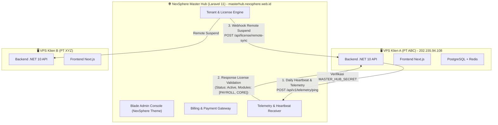
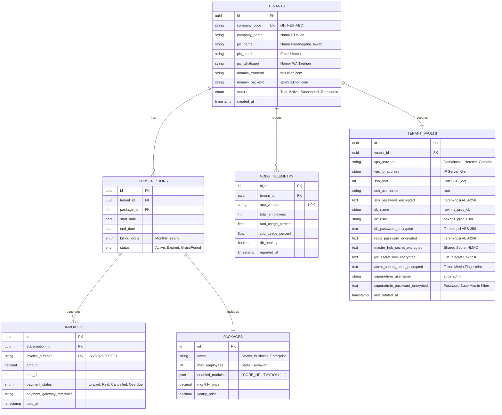

# Master Plan: NexSphere Master Hub (Laravel Versi Terbaru & Custom Blade Admin)
**Arsitektur**: *Standalone SaaS Central Control Plane (Repository & Folder Terpisah)*  
**Framework**: *Laravel 13.x (Terbaru) + PHP 8.3*  
**Template UI**: *NexSphere Studio Admin Theme (Bootstrap 5, Blade, DataTables, Dark/Light Mode)* — Diambil dari template admin `companyprofile`  
**Target Domain**: `masterhub.nexsphere.web.id` (Shared Hosting cPanel / Subdomain)  
**CI/CD**: *GitHub Actions SSH Deploy (Rsync + Auto Cache/Migration)*  
**Status**: Perencanaan Disetujui & Siap Dieksekusi  

---

## 1. Visi & Tujuan Master Hub

Master Hub adalah **Pusat Komando (*Central Control Plane*)** untuk seluruh ekosistem bisnis NexSphere-HRIS. 

Ketika NexSphere-HRIS beroperasi sebagai model **Single-Tenant VPS** (setiap klien/perusahaan memiliki VPS mandiri seperti VPS Domainesia saat ini), Master Hub berperan sebagai server induk yang mengelola:
1. **Direktori Tenant / Klien**: Siapa saja perusahaan yang menggunakan NexSphere-HRIS.
2. **Lisensi & Paket Modul**: Menentukan modul apa saja yang dibeli (Payroll, Rekrutmen, KPI, LMS, dll) dan batas kuota karyawan.
3. **Billing & Langganan Otomatis**: Invoice bulanan/tahunan, integrasi Payment Gateway (Midtrans/Xendit), dan bukti bayar.
4. **Heartbeat & Telemetri Node VPS**: Memantau apakah VPS klien aktif, versi aplikasi, pemakaian RAM/CPU, dan status kesehatan database.
5. **Remote Kill-Switch / Auto-Suspension**: Mengunci akses login di VPS klien secara otomatis jika masa langganan habis atau menunggak pembayaran.

---

## 2. Mengapa Laravel 11 + Template Admin Custom NexSphere?

Menggunakan **Blade + Bootstrap 5 Admin Template (yang sudah ada di `companyprofile`)** memberikan keunggulan konkret:

| Aspek | Keunggulan Template Admin Custom NexSphere |
| :--- | :--- |
| **Konsistensi UI Ekosistem** | Tampilan, sidebar, header, dark/light mode switcher, dan icon sama persis dengan aplikasi `companyprofile` NexSphere Studio. Desain terlihat seragam, profesional, dan branded. |
| **Kontrol Penuh & Fleksibel (100% Custom)** | Bebas dari batasan/konvensi kaku framework admin (seperti Filament/Livewire). Sangat mudah mengintegrasikan modal Vault password, clipboard JS, grafik telemetri interaktif, dan DataTables. |
| **Keamanan & API Modern** | Dilengkapi **Laravel Sanctum** untuk otentikasi API Token aman (`MASTER_HUB_SECRET`) yang menghubungkan Master Hub dengan ratusan VPS klien. |
| **Ekosistem Billing & Task Scheduling** | Scheduler cron job bawaan Laravel (`schedule:run`) sangat andal untuk memeriksa jatuh tempo langganan setiap tengah malam dan mengirim notifikasi WhatsApp/Email tagihan. |
| **Isolasi Penuh (*Separation of Concerns*)** | Terpisah total dari repositori HRIS. Jika VPS klien mengalami kendala, Master Hub tetap online 100%. Sebaliknya jika Master Hub maintenance, VPS klien tetap bisa beroperasi normal dengan mekanisme *offline token buffer*. |

---

## 3. Arsitektur Komunikasi: Master Hub $\leftrightarrow$ VPS Node HRIS



---

## 4. Struktur Database Master Hub (MySQL / PostgreSQL)

Database Master Hub dirancang sederhana, kuat, dan berfokus pada multi-tenant orchestration:



---

## 5. Fitur Utama di Admin Console Master Hub (NexSphere Blade Theme)

### A. Dashboard Eksekutif SaaS
* Total Klien Aktif, Klien Masa Trial, dan Klien Jatuh Tempo.
* Monthly Recurring Revenue (MRR) & Annual Recurring Revenue (ARR).
* Grafik utilisasi server klien (indikator VPS yang kehabisan RAM atau disk penuh).

### B. Modul Manajemen Klien & Lisensi
* Form pembuatan Klien Baru: Otomatis generate `company_code`, `master_hub_secret`, dan konfigurasi template `.env` siap copy-paste ke VPS.
* Sakelar Fitur Modul Granular: Checkbox untuk mengaktifkan/menonaktifkan modul tertentu per klien (`Payroll`, `Recruitment`, `LMS`, `Performance KPI`, `EWA Kasbon`, `Asset Inventory`).

### C. Modul Billing & Otomasi Tagihan
* Pembuatan Invoice Otomatis H-7 sebelum jatuh tempo langganan.
* Integrasi Payment Gateway (QRIS, Virtual Account, Transfer Bank).
* Tombol darurat: **Perpanjang Masa Tenggang (*Grace Period*)** jika klien meminta kelonggaran pembayaran.

### D. Fitur Sakelar Pembekuan Jarak Jauh (*Remote Kill-Switch*)
* Jika status klien diubah menjadi **`Suspended`**:
  * Master Hub mengirim sinyal enkripsi ke endpoint VPS klien (`POST /api/governance/license/sync`).
  * VPS klien seketika mengunci layar login Web Admin & Mobile ESS dengan pesan profesional:
    > *"Layanan NexSphere-HRIS perusahaan Anda sedang ditangguhkan sementara. Hubungi tim Administrator atau Finance untuk aktivasi kembali."*

### E. Brankas Kredensial & Manajemen Password VPS Klien (*Tenant Credential Vault*)
Fitur khusus untuk SuperAdmin Master Hub mengelola dan mengamankan seluruh rahasia infrastruktur per klien:
1. **Penyimpanan Terenkripsi AES-256 (At-Rest Encryption)**:
   * Seluruh password (SSH root, password DB PostgreSQL, Redis, JWT Secret, Token Fingerprint, dan Password SuperAdmin Web) disimpan menggunakan enkripsi tingkat militer `Crypt::encryptString()` via casting `$casts = ['ssh_password' => 'encrypted']` di Laravel.
2. **Tombol Otomasi "1-Klik Generate .env Produksi"**:
   * Di halaman detail tenant, terdapat tombol **"Salin Konfigurasi .env"**. Mengklik tombol ini langsung men-generate seluruh isi file `.env` produksi siap paste ke VPS klien baru tanpa risiko salah ketik.
3. **Kartu Kredensial Klien (Siap Kirim WhatsApp/Email)**:
   * Tombol **"Kirim Kredensial Akun"** yang memformat pesan siap kirim ke PIC klien:
     ```text
     Halo [Nama PIC], layanan NexSphere HRIS perusahaan Anda telah aktif!
     URL: https://hris.[klien].com
     Username: superadmin
     Password Sementara: [PasswordTer-generate]
     ```
4. **Remote Reset Password SuperAdmin via Master Hub**:
   * Jika klien lupa password SuperAdmin mereka, Anda tidak perlu repot membuka terminal SSH VPS klien. Cukup klik tombol **"Reset Password SuperAdmin"** di Master Hub, tentukan password baru, dan Master Hub akan mengirim instruksi enkripsi ke VPS klien untuk memperbarui password seketika!
5. **Jejak Audit Akses Kredensial (Kepatuhan UU PDP)**:
   * Setiap kali staff atau admin Master Hub mengintip (*reveal*) password VPS/DB atau menyalin kredensial klien, sistem otomatis mencatat di tabel `AuditLogs` (Siapa yang melihat, kapan, dan dari IP mana).

---

## 6. Spesifikasi Kontrak API (Protokol Komunikasi)

### 1. Endpoint Heartbeat & Lisensi (Dipanggil oleh VPS Klien)
* **Route**: `POST /api/v1/node/heartbeat`
* **Headers**: `X-Hub-Secret: {MASTER_HUB_SECRET}`
* **Payload dari VPS**:
  ```json
  {
    "companyCode": "NEXSPHERE",
    "appVersion": "1.0.0",
    "totalEmployees": 45,
    "dbHealthy": true,
    "uptimeSeconds": 86400
  }
  ```
* **Respons dari Master Hub**:
  ```json
  {
    "status": "Active",
    "licenseExpiresAt": "2027-09-30T23:59:59Z",
    "maxEmployees": 100,
    "enabledModules": ["CORE_HR", "ATTENDANCE", "PAYROLL", "LEAVES", "LOANS", "DISCIPLINARY", "OFFBOARDING"],
    "serverNotice": null
  }
  ```

---

## 7. Rencana Folder & Tahapan Pengerjaan Mandiri

Proyek Master Hub dibuat di folder ini:
* **Lokasi Folder**: `c:\Users\Yusuf\Desktop\Project\masterhub`
* **Teknologi & Asset**:
  * PHP 8.3.30
  * Laravel 13.x (Versi Terbaru)
  * Laravel Sanctum 4.x
  * Template UI: NexSphere Studio Admin Theme (Bootstrap 5, DataTables, Dark/Light mode dari `companyprofile/public/admin-assets`)
  * Database: MySQL / MariaDB (Kompatibel dengan cPanel Shared Hosting)
  * Target Domain: Subdomain `masterhub.nexsphere.web.id`

---

### Roadmap Eksekusi Pembangunan Master Hub:

1. **Tahap 1: Inisialisasi Proyek Laravel 13 & Integrasi Template Admin NexSphere**
   * Setup proyek baru Laravel versi terbaru di folder `masterhub`.
   * Salin aset (`admin-assets`), layout Blade (`master.blade.php`, sidebar, header, footer) dari `companyprofile`.
   * Konfigurasi Auth (Login Admin Master Hub).
2. **Tahap 2: Skema Database & CRUD Tenant / Lisensi / Vault**
   * Migrasi tabel: `tenants`, `packages`, `subscriptions`, `tenant_vaults`, `node_telemetries`.
   * Antarmuka DataTables visual data klien, generator token `MASTER_HUB_SECRET`, dan modal brankas kredensial (AES-256).
3. **Tahap 3: Implementasi Heartbeat API & Remote Control**
   * Pembuatan endpoint API penerima telemetri node VPS, verifikasi secret HMAC/token, dan endpoint remote kill-switch / remote reset password.
4. **Tahap 4: Sistem Billing & Otomasi Tagihan**
   * Modul invoice, pencatatan pembayaran langganan, dan pengingat jatuh tempo.
5. **Tahap 5: Setup CI/CD GitHub Actions ke Shared Hosting (cPanel)**
   * Workflow `.github/workflows/deploy.yml` dengan automated Rsync via SSH (`easingthemes/ssh-deploy` + `appleboy/ssh-action`).
   * Konfigurasi struktur pemisahan `core app` dan `public_html/subdomain`.
   * Otomasi `composer install --no-dev`, `php artisan migrate --force`, dan `php artisan optimize`.
6. **Tahap 6: Integrasi Live Node VPS HRIS ke Master Hub**
   * Menghubungkan VPS node HRIS live ke subdomain `masterhub.nexsphere.web.id`.

---

## 8. Arsitektur CI/CD Shared Hosting (GitHub Actions)

Alur otomatisasi deployment saat push ke branch `main`:

```mermaid
flowchart LR
    A["Push commit ke GitHub (main)"] --> B["GitHub Actions Runner (Ubuntu)"]
    B --> C["Composer Install & Build Assets"]
    C --> D["Deploy Core via SSH Rsync"]
    D --> E["Sync public/ ke Document Root Subdomain"]
    E --> F["Symlink Storage & Run Migrate --force"]
    F --> G["php artisan optimize & Cache Reset"]
    G --> H["✅ Live di masterhub.nexsphere.web.id"]
```



### GitHub Secrets yang Diperlukan:
* `SSH_HOST`: IP atau host server shared hosting
* `SSH_USER`: Username SSH cPanel
* `SSH_KEY`: Private Key SSH (ed25519 atau RSA)
* `SSH_PORT`: Port SSH (biasanya 22 atau custom port hosting)
* `REMOTE_TARGET`: Path folder core app di hosting (misal: `/home/user/nexsphere-masterhub`)
* `PUBLIC_HTML_PATH`: Path document root subdomain (misal: `/home/user/public_html/hub`)

